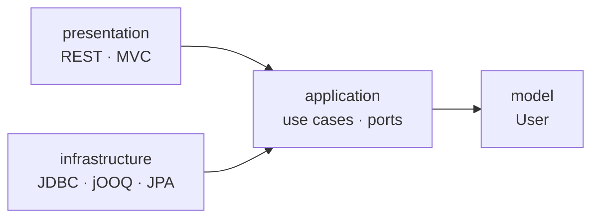

<div align="center">

# clean-architecture

**A small Spring Boot CRUD app that demonstrates Clean Architecture (ports & adapters)**

Strict dependency direction · three swappable storage adapters · CQRS-style read/write split


</div>

---

> The domain is intentionally trivial (`User`). **The structure is the point, not the functionality.**

## Idea

Dependencies point inward:

```
presentation   ──►  application  ──►  model
infrastructure ──►  application
```

| Layer | Responsibility |
|---|---|
| **model** | Depends on nothing. |
| **application** | Describes use cases and repository ports. No Spring, no infrastructure. |
| **infrastructure** | Implements the ports (JDBC, jOOQ, JPA) and wires the application together. |
| **presentation** | REST and server-rendered HTML. Talks to use cases only. |



## Package structure

Root package: `dev.dmitriirussu.clean.architecture`

| Package | Contents |
|---|---|
| `model` | `User`, no dependencies |
| `application.usecase` | `UserCommandUseCase`, `UserQueryUseCase`, commands, `UserView` |
| `application.repository` | Ports: `UserCommandRepository`, `UserQueryRepository` |
| `application.service` | Use case implementations (package-private) |
| `application.exception` | `UserNotFoundException` |
| `infrastructure.jdbc` | `JdbcClient` and SQL files |
| `infrastructure.jooq` | jOOQ DSL |
| `infrastructure.jpa` | Spring Data JPA and `EntityManager` |
| `infrastructure.bootstrap` | Component scanning and transactions |
| `presentation.rest` | `/api/users` |
| `presentation.mvc` | `/mvc/users` (jte templates) |
| `presentation.shared` | Requests, responses, mapper |

## Design decisions

### CQRS split
Separate `UserCommandUseCase` and `UserQueryUseCase`, separate `UserCommandRepository` and `UserQueryRepository`. Reads return `UserView`; writes accept `User`.

### No framework annotations in the core
`application` and `model` have no Spring imports. Services are plain package-private classes, registered by a filtered component scan (by port type) in `infrastructure.bootstrap`. The `Service` suffix in implementation names is just a name, not the Spring `@Service` stereotype.

### Transactions without `@Transactional`
`TransactionConfig` attaches a `TransactionInterceptor` to the use case interfaces via an `Advisor`: **read-only** for queries, **read-write** for commands.

Because the implementations are `final`, JDK proxies are used (`spring.aop.proxy-target-class=false`).

> ⚠️ Do **not** set it to `true`: CGLIB cannot proxy `final` classes.

### Package-private implementations
Services and adapters are invisible outside their packages. Only the interfaces are public.

### Explicit SQL
The JDBC adapter keeps its SQL in `src/main/resources/sql/`.

## Switching the adapter

Exactly one adapter is active, selected by a single constant in `AdapterWiringConfig`:

```java
static final String ADAPTER = JDBC; // JDBC | JOOQ | JPA
```

In `pom.xml`, keep **only** the starter for the chosen adapter (`jdbc`, `jooq` or `data-jpa`). Otherwise Spring Data JPA auto-configuration will bring up extra infrastructure even when JDBC is selected.

The `portsAreWired` test fails if any port has anything other than exactly one implementation, including when no adapter is found.

`application` and `presentation` code stays unchanged when you swap adapters.

## How isolation is enforced

Protection doesn't rely on developer discipline or on tests alone. It is layered:

| Level | Mechanism | What it guarantees |
|---|---|---|
| **Compiler** | package-private types | Service implementations and adapters (`UserQueryService`, `JdbcQueryRepository`, `JooqCommandRepository`, …) can't be referenced from another package: the code won't compile. Subpackages don't count as the same package. `infrastructure` has no public types, so `application` and `presentation` can't depend on it at code level. Only public interfaces (use cases and ports) are visible. |
| **Build** | ArchUnit | The compiler can't see dependency direction between public types (e.g. `application -> presentation`). `ArchitectureTest` checks these rules at the `test` stage: a violation fails the build instead of staying a recommendation. |
| **Startup** | Spring context | Implementations aren't wired in code; component scan finds them by public port. `portsAreWired` checks exactly one implementation per port; `useCasesAreTransactionalProxies` checks that use cases are wrapped in transactional proxies. |
| **Behavior** | End-to-end tests | `UserApiTest` passes identically on any adapter. |

### Inbound adapters
REST and MVC work only through `UserCommandUseCase` and `UserQueryUseCase` and don't depend on each other (verified by ArchUnit). Either one can be deleted together with its package without touching the core or other layers. Some classes in `presentation.shared` may be left unused afterwards.

## API

| Method | Endpoint | Description | Response |
|---|---|---|---|
| `GET` | `/api/users` | List users, optional `namePrefix` parameter | `200` |
| `GET` | `/api/users/{id}` | Get one user | `200`, or `404` if not found |
| `POST` | `/api/users` | Create a user | `201` + `Location` header |
| `PUT` | `/api/users/{id}` | Update a user | `204` |
| `DELETE` | `/api/users/{id}` | Delete a user | `204` |

**HTML interface:** <http://localhost:8080/mvc/users>

Seed data lives in `data.sql` (three users); the schema is in `schema.sql`.

## Tests

| Test | What it checks |
|---|---|
| `ArchitectureTest` (ArchUnit) | Layer dependency direction, core free of Spring, no public types in `infrastructure`, REST and MVC independence |
| `CleanArchitectureApplicationTests` | Context starts, one implementation per port, use cases are transactional JDK proxies |
| `UserApiTest` | End-to-end through REST: read, 404, create, update, delete. **Run it after switching adapters.** |

## Running

```bash
./mvnw spring-boot:run   # start the app
./mvnw test              # run all tests
```

## Limits of this example

This is a single Maven module. Isolation comes from the compiler (package-private), ArchUnit and context tests. Not covered:

- Reflection bypasses package-private (Spring uses it, and that's fine).
- Public types in `model`, `application` and `presentation` are visible to everyone within the module; their dependencies are controlled only by ArchUnit.

Full compiler-level isolation requires splitting into modules (Maven or JPMS): an illegal dependency simply isn't on the module's classpath. Suggested module layout:

```
model
application              (depends on model)
infrastructure-jdbc      (depends on application)
infrastructure-jooq      (depends on application)
infrastructure-jpa       (depends on application)
presentation-rest        (depends on application)
presentation-mvc         (depends on application)
app                      (assembles the chosen modules)
```

Swapping an adapter or controllers then comes down to changing a dependency in the `app` module's `pom.xml`.

That is out of scope for this example. **Input validation** is also out of scope.
